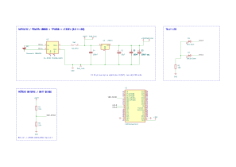

# vMix Tally Light (ESP32)

Battery-powered WiFi tally light for [vMix](https://www.vmix.com/). An ESP32 DevKit V1
connects to the vMix TCP API, subscribes to tally updates and drives a red (PROGRAM)
and a green (PREVIEW) LED for one selected input.

## Schematic

Full KiCad project (schematic, PCB, custom symbols and footprints) is in `schematics/`, PDF export in `schematics/vmix_tally_18650.pdf`.

## Hardware

Rev 3, single 18650 cell with a linear 3.3 V regulator.

| Ref | Part | Role | Source |
| --- | --- | --- | --- |
| U1 | ESP32 DevKit V1 (ESP-WROOM-32, 30 pin, USB-C, CH340) | MCU, WiFi, web UI | [GME 775-652](https://www.gme.cz/v/1519254/vyvojova-deska-esp-wroom-32-usb-c-ch340-esp32) |
| BT1 | Panasonic NCR18650GA, 3450 mAh | Li-ion cell | [GME 540-579](https://www.gme.cz/v/1507018/panasonic-18650ga-li-ion-3450mah-akumulator) |
| – | BHC-18650-1P | Battery holder | [GME 819-148](https://www.gme.cz/v/1506919/bhc-18650-1p-drzak-baterie-18650) |
| U3 | TP4056 + DW01 module, USB-C | Charging, over-discharge protection | [Drátek](https://dratek.cz/arduino-platforma/34679-nabijeci-deska-li-ion-baterii-usb-c.html) (GME 775-625) |
| U2 | LF33CV (TO-220) | 3.3 V LDO feeding the 3V3 pin directly | [GME 330-165](https://www.gme.cz/v/1488555/stmicroelectronics-lf33cv) |
| – | CU-TA 020 perfboard, 100 x 50 mm | Carrier board | GME 661-201 |
| – | CONNFLY BL115G-V8.5, 2x 1x15 pin female header, 2.54 mm | Socket for the ESP32 board | GME 832-052 |
| C1, C2 | 10 µF, 100 µF (optional) | LDO output / input capacitors | |
| C3, C4 | 100 nF | Decoupling | |
| D1, D2 | 5 mm LED, red / green | PROGRAM / PREVIEW | |
| R3 | 100 Ω | Shared LED cathode resistor | |
| R1, R2 | 10 kΩ | 1:2 divider for battery voltage sense | |
| SW1 | SPST switch | Power switch | |

Parts list total from GME / Drátek: about 614 Kč (October 2026).

## Firmware

- Connects to vMix on TCP port 8099 and sends `SUBSCRIBE TALLY`.
- Web interface on port 80: status, input selection with names pulled from vMix, brightness, vMix IP, device name, identify (blink LEDs), WiFi credentials. Settings persist in NVS.
- First boot or no WiFi: the device opens its own access point `Tally-XXXX` with a captive portal at `192.168.4.1`. Once home WiFi is configured it is reachable at `http://<name>.local`.
- Battery voltage is averaged and shown in the web UI. The on-board blue LED blinks on low battery.
